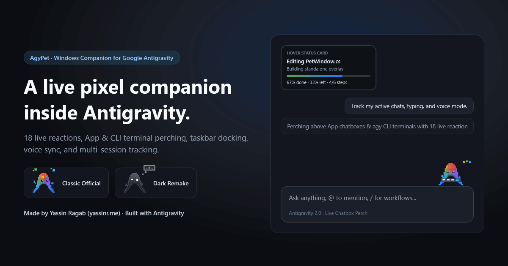

# AgyPet — Live Pixel Companion for Google Antigravity

[](https://github.com/yvs1n/agypet/actions/workflows/ci.yml)
[](https://github.com/yvs1n/agypet/actions/workflows/release.yml)
[](https://github.com/yvs1n/agypet/releases/latest)
[](LICENSE)

A lightweight, one-file install-and-play pixel companion overlay for **Google Antigravity App**, **Antigravity IDE**, and **Antigravity CLI (`agy`)** on **Windows**, **macOS**, and **Linux**.



---

## Download & Install (One-File Run)

Download the single file for your OS from [`yvs1n/agypet` Latest Release](https://github.com/yvs1n/agypet/releases/latest) — no runtime installation required:

- **Windows**: **[`AgyPet.exe`](https://github.com/yvs1n/agypet/releases/latest/download/AgyPet.exe)** — double-click to run (~160 KB portable WPF executable; if SmartScreen prompts on an unsigned build, click **More info → Run anyway**).
- **macOS (Apple Silicon & Intel Universal)**: **[`AgyPet-macOS.dmg`](https://github.com/yvs1n/agypet/releases/latest/download/AgyPet-macOS.dmg)** — true `lipo` Universal app (`MenuBarAgent` monochrome template icon + right-click support); drag `AgyPet.app` into **Applications** or run straight from the `.dmg`.
- **Linux (`x64` / `arm64`)**: **[`AgyPet-linux-x64`](https://github.com/yvs1n/agypet/releases/latest/download/AgyPet-linux-x64)** or **[`AgyPet-linux-arm64`](https://github.com/yvs1n/agypet/releases/latest/download/AgyPet-linux-arm64)** — self-contained single binary (~20 MB trimmed): run `chmod +x AgyPet-linux-x64 && ./AgyPet-linux-x64` (zero extra dependencies or FUSE needed).
- **Auto-Updates & Startup Sync**: AgyPet checks [`yvs1n/agypet` Releases](https://github.com/yvs1n/agypet/releases) from the right-click / menu-bar tray menu (**Check for Updates**), and automatically keeps your login startup entry synced if you move or update the binary.

---

## Features

- **Adaptive Chatbox Perch & Smart Visibility**: Floats above the top-right corner of Antigravity's chat composer without occupying side-panel space or requiring Electron patching/CDP debug flags. Automatically tracks attachments and multi-line prompts, and on Windows stays perched while clicking the tray or using side-by-side windows (`IsTargetVisible`), docking away only when minimized or covered.
- **Precise Sizing & Anchored Gaze**: Continuous size slider (`2.4–7.2 px`, `60%–171%`) with automatic taskbar/dock-safe scaling, anchored eye sockets with cursor-following pupils in `Idle`/`Listening`, and live animated pupils across moods.
- **Headphones & Music Sync (Windows, macOS & Linux)**: Optional **Headphones (Music Notes)** toggle renders theme-matched pixel headphones and floating notes (`♫` / `♪`) whenever system audio plays (WASAPI on Windows, `CoreAudio` on macOS, ALSA/`pactl` on Linux), suppressed automatically during Voice Mode.
- **CLI Terminal Perch**: Detects Antigravity CLI (`agy` / `agy-cli`) across Windows Terminal, iTerm2, Ghostty, PowerShell, CMD, Alacritty, WezTerm, Warp, Hyper, Tabby, and Mintty with configurable placement (`Bottom-Right`, `Bottom-Middle`, `Bottom-Left`, `Top-Right`, `Top-Left`, or `Off`).
- **Anti-Flicker Dwell & Instant File Wakeup**: Uses native filesystem watchers for sub-100ms transcript reactions plus minimum busy-state dwell so fast tool chains stay crisp.
- **Context-Aware Per-Chat Tracking**: Matches your active conversation across App, IDE, and CLI. Shows `Typing` while you or the agent type, `Listening` during dictation, and flips between `Listening` and `Speaking` in Voice Mode.
- **Dock, Taskbar & Auto-Hide**: Glides to `Top-Right`, `Top-Left`, `Bottom-Left` / `Bottom-Middle` / `Bottom-Right` (`bottom-center` default on macOS above the Dock), or directly along the taskbar/dock with optional **Auto-Hide** toggles (`Hide When Inactive` / `Hide When Minimized`).
- **Multitasking & Live Server States**: Juggles 2–8 orbiting session orbs when away with multiple active sessions, and displays a pulsing server rack when a finished chat keeps a dev server running.
- **Scrollable Multi-Session Hover Card**: Outside Antigravity, hover the mascot to view every active App, IDE, and CLI session with exact `% done / % left` step progress (scrollable at > 2 sessions).
- **Idle Leg-Hop & Rapid-Click Wince**: Left-clicking when `Idle` hops playfully from leg to leg (or wakes from `Sleeping`); 3+ rapid clicks dance when `Idle` or wince (`> <`) while busy; left-drag anywhere freely.
- **Two Official Skins**:
  - **Classic Official** — Official Antigravity radial colors with slate/sky-blue headphones and cyan/gold accents.
  - **Dark Remake** — Monochrome obsidian & graphite remake with luminous eyes and matching monochrome headphones & notes.

### Classic Official Skin (All 18 Live Reactions)


### Dark Remake Skin (All 18 Live Reactions)


---

## All 18 Live Reactions

| Reaction | Trigger in Antigravity |
| :--- | :--- |
| **Typing** | Agent streaming a text reply, or you typing in the chatbox / CLI |
| **Thinking** | Planner reasoning before tool calls (chin-ponder + neural thought cloud) |
| **Working** | `edit_file`, `write_file`, and file updates |
| **Terminal** | `run_command` / shell execution |
| **Browsing** | Browser automation & DevTools steps |
| **Delegating** | `invoke_subagent`, `swarm`, and `run_workflow` (dispatching to worker nodes) |
| **Reading** | `read_file`, `grep`, `glob`, `list` |
| **Searching** | `search_web`, `search_marketplace`, `fetch` |
| **Listening** | Dictation mic active, or user speaking in Voice Mode |
| **Speaking** | Antigravity speaking aloud in Voice Mode |
| **Multitasking** | Minimized / away with 2+ active sessions running |
| **Background** | Chat finished while a live server / daemon remains active |
| **Alert** | Permission or approval needed |
| **Question** | `ask_question` waiting for your choice |
| **Done** | Task finished celebration |
| **Error** | Turn or tool failure (`> <` glitch squint & flashing lightning bolt) |
| **Idle** | Ready at rest |
| **Sleeping** | Quiet after extended idle |

---

## Controls

- **Left-click mascot**: When `Idle`, single-click hops from one leg to the other (or wakes up first if `Sleeping`). Rapid clicks (3+ times) trigger the original wince (`> <`) whether `Idle` or working; single-clicking while busy stays calm.
- **Double-click mascot**: Continues the Idle click cadence.
- **Left-drag**: Move freely anywhere on screen (always returns above chatbox when returning to Antigravity).
- **Hover (when outside Antigravity)**: View live status & scrollable multi-session progress card.
- **Right-click / Menu Bar / System Tray**: Switch skins (`Classic` / `Dark Remake`), toggle **Headphones (Music Notes)**, set away location (`Top-Left` / `Top-Right` / `Bottom-Left` / `Bottom-Middle` / `Bottom-Right` / `Taskbar or Dock · Left · Middle · Right`), **Pin Above Taskbar / Dock**, **Lock Position**, configure **CLI Terminal Placement**, toggle **Auto-Hide** (`Hide When Inactive` / `Hide When Minimized`), adjust exact **Size** (`2.4–7.2 px`), preview all 18 moods, toggle launch on login, **Check for Updates**, or **Send Feedback (GitHub Issue)**.

---

## Build from Source

**Windows** requires zero SDK installs — builds with Windows' built-in `.NET Framework 4.x` C# compiler:

```powershell
# Build bin\AgyPet.exe
.\build.ps1

# Run unit tests
.\build.ps1 -Test

# Render docs\showcase-*.png & site\og-screen.png
.\build.ps1 -Showcase
```

**macOS & Linux** use the shared `.NET 8` + Avalonia project under `cross/`:

```bash
# Run cross-platform unit tests
dotnet run --project cross/tests/AgyPet.Cross.Tests.csproj -c Release

# Build release binary
dotnet build cross/AgyPet.Cross.csproj -c Release
```

---

## Feedback & Issues

Have an idea for a new reaction or spotted a bug? Submit directly via:
- **[Open a GitHub Issue](https://github.com/yvs1n/agypet/issues/new/choose)**
- Or right inside the app (**Right-click / Tray → Send Feedback...**) or on the **[landing page](site/index.html#feedback)**.

---

## Credits

Made by **[Yassin Ragab](https://yassinr.me)** for **[Google Antigravity](https://antigravity.google)**, built with Antigravity.

*(See [CHANGELOG.md](CHANGELOG.md) for historical attribution on prior releases `0.2.0`–`0.2.3`.)*

## License

[MIT](LICENSE)
