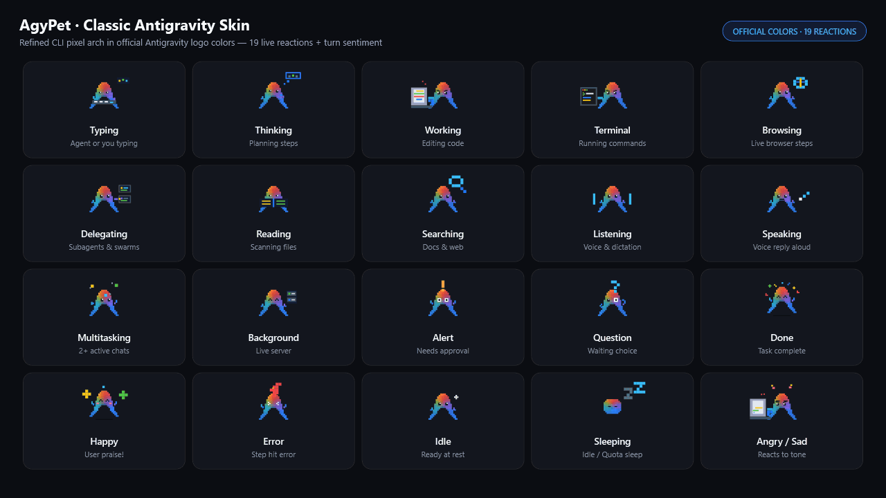
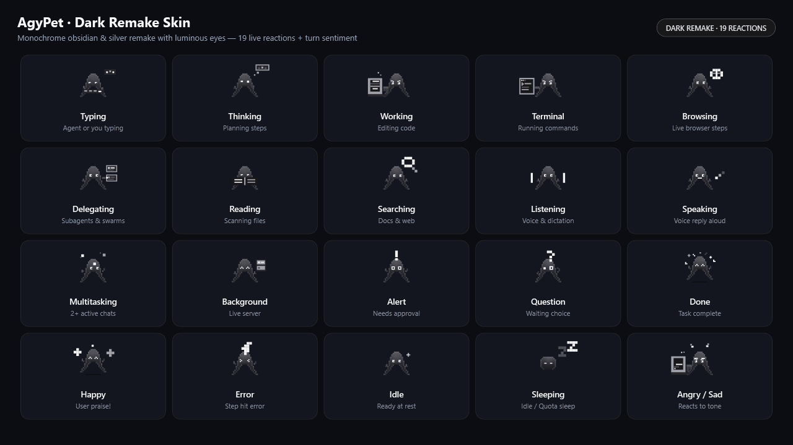

# AgyPet — Live Pixel Companion for Google Antigravity

[](https://github.com/yvs1n/agypet/actions/workflows/ci.yml)
[](https://github.com/yvs1n/agypet/actions/workflows/release.yml)
[](https://github.com/yvs1n/agypet/releases/latest)
[](LICENSE)

A lightweight, zero-dependency Windows pixel-art mascot overlay for **Google Antigravity App**, **Antigravity IDE**, and **Antigravity CLI (`agy`)**.


---

## Download & Install

**[Download latest `AgyPet.exe`](https://github.com/yvs1n/agypet/releases/latest/download/AgyPet.exe)** (single portable executable, ~150 KB, no installer or runtime needed).

- **Auto-Updates**: AgyPet automatically checks [`yvs1n/agypet` Releases](https://github.com/yvs1n/agypet/releases) and can update itself in-place from the right-click or system tray menu (**Check for Updates**).
- **Windows SmartScreen**: Because the binary isn't EV code-signed yet, click **More info → Run anyway** on first launch (or verify the SHA-256 checksum listed in each release).

---

## Features

- **Adaptive Chatbox Perch**: Floats cleanly right above the top-right corner of Antigravity's chat composer without occupying side-panel space or requiring Electron patching/CDP debug flags. Automatically tracks attachments, multi-line prompts, and `Small` / `Medium` / `Large` sizes at 60fps.
- **Turn Sentiment Moods & Quota Sleep**: `Angry` (furrowed brows + animated steam puffs) and `Sad` (drooping brows + falling pixel teardrop) react to your tone across active steps (while ignoring code blocks and SQL), `Happy` celebrates praise with rosy cheeks & aurora stars, and **Quota Sleep** naps when hitting 429/quota limits until you switch models.
- **Anti-Flicker Dwell & Instant File Wakeup**: Uses native `FileSystemWatcher` for sub-100ms reaction to Antigravity writes plus a `1.2s` minimum busy-state dwell so fast tool chains never strobe.
- **Context-Aware Per-Chat Tracking**: Matches whichever conversation you currently have open. Shows `Typing` when either the agent or you are typing, `Listening` during dictation, and flips between `Listening` and `Speaking` in Voice Mode.
- **Alt+Tab, Corner & Taskbar Dock**: Leaves the chatbox when you switch apps or open Settings, gliding calmly to `Top-Right`, `Top-Left`, above the taskbar (`Bottom-Left` / `Bottom-Middle` / `Bottom-Right`), or directly along the taskbar (`Taskbar · Left` / `Taskbar · Middle` / `Taskbar · Right`). Return to Antigravity and he snaps right back above the chatbox.
- **Multitasking & Live Server States**: Juggles orbiting orbs when minimized with 2+ active sessions, follows a single session directly, and displays a calm pulsing server rack when a finished chat still has a live server running.
- **Scrollable Multi-Session Hover Card**: Outside Antigravity, hover over the mascot to view every active App, IDE, and CLI session with exact `% done / % left` step progress (automatically scrollable at > 2 sessions).
- **Double-Click Dance & Subtle Press Fidget**: Double-click when calm (`Idle` / `Done` / `Happy`) for a dance groove, or single-click above the chatbox for a brief subtle wince; left-drag anywhere freely.
- **Two Official Skins**:
  - **Classic Official** — Refined CLI pixel-art arch in the official Antigravity radial logo colors.
  - **Dark Remake** — Monochrome obsidian & graphite remake with luminous white eyes.

### Classic Official Skin (All 19 Live Reactions)


### Dark Remake Skin (All 19 Live Reactions)


---

## All 19 Live Reactions

| Reaction | Trigger in Antigravity |
| :--- | :--- |
| **Typing** | Agent streaming a text reply, or you typing in the chatbox |
| **Thinking** | Planner reasoning before tool calls (chin-ponder + neural thought cloud) |
| **Working** | `edit_file`, `write_file`, and file updates |
| **Terminal** | `run_command` / shell execution |
| **Browsing** | Browser automation & DevTools steps |
| **Delegating** | `invoke_subagent`, `swarm`, and `run_workflow` (dispatching to worker nodes) |
| **Reading** | `read_file`, `grep`, `glob`, `list` |
| **Searching** | `search_web`, `search_marketplace`, `fetch` |
| **Listening** | Dictation mic active, or user speaking in Voice Mode |
| **Speaking** | Antigravity speaking aloud in Voice Mode |
| **Multitasking** | Minimized / away with 2+ active sessions running |
| **Background** | Chat finished while a live server / daemon remains active |
| **Alert** | Permission or approval needed |
| **Question** | `ask_question` waiting for your choice |
| **Done** | Task finished celebration |
| **Happy** | Rosy blush & aurora stars on user praise ("thanks!", "perfect!") |
| **Error** | Turn or tool failure (`> <` glitch squint & flashing lightning bolt) |
| **Idle** | Ready at rest |
| **Sleeping** | Quiet after extended idle, or model quota limit reached |

---

## Controls

- **Left-click above chatbox**: Subtle press wince reaction.
- **Double-click when calm**: Joyful dance groove (`Idle` / `Done` / `Happy`).
- **Left-drag**: Move freely anywhere on screen (always returns above chatbox when returning to Antigravity).
- **Hover (when outside Antigravity)**: View live status & scrollable multi-session progress card.
- **Right-click / System Tray**: Switch skins (`Classic` / `Dark Remake`), set away location (`Top-Left` / `Top-Right` / `Bottom-Left` / `Bottom-Middle` / `Bottom-Right` / `Taskbar · Left` / `Taskbar · Middle` / `Taskbar · Right`), resize (`Small` / `Medium` / `Large`), preview all 19 moods + turn sentiments, toggle `Start with Windows`, **Check for Updates**, or **Send Feedback (GitHub Issue)**.

---

## Build from Source (Windows)

Requires zero SDK installs — builds with Windows' built-in `.NET Framework 4.x` C# compiler:

```powershell
# Build bin\AgyPet.exe
.\build.ps1

# Run unit tests
.\build.ps1 -Test

# Render docs\showcase-*.png & site\og-screen.png
.\build.ps1 -Showcase
```

---

## Feedback & Issues

Have an idea for a new reaction or spotted a bug? Submit directly via:
- **[Open a GitHub Issue](https://github.com/yvs1n/agypet/issues/new/choose)**
- Or right inside the app (**Right-click / Tray → Send Feedback...**) or on the **[landing page](site/index.html#feedback)**.

---

## Credits

Made by **[Yassin Ragab](https://yassinr.me)** for **[Google Antigravity](https://antigravity.google)**, built with Antigravity.

## License

[MIT](LICENSE)
